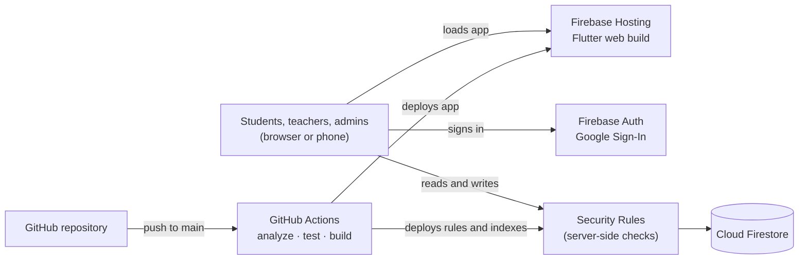

# Course Registration System

A web app that runs elective course registration (수강신청) for a high school. I designed and built it on my own as a personal project, and the school uses it with my permission.

**Solo project · Flutter + Firebase · in use since July 2026 · about 150 students and 20 teachers**

> This repository is a written case study. The source code lives in a private repository, and any screenshots use synthetic data.

## The problem

This was the first time the school needed students to sign up for electives. Until then, anything similar went through Google Forms. A form records answers, but it can't stop a class from overfilling, catch two classes at the same time, or open sign-up one grade at a time. Those rules had to be enforced while students registered.

## What I built

- **Registration with capacity limits and a waitlist**, enforced at the moment of registration.
- **Registration rules:** each grade registers only in its own window, a course can't be taken twice, even across terms, and a student's classes can't overlap in time.
- **Three roles:** students, teachers and administrators, with separate views and permissions.
- **Timetables and rosters:** personal and staff timetables, and teachers manage their own class lists.
- **School paperwork:** bulk import from CSV/Excel, and attendance sheets generated in the school's own Excel form.

## Tech stack

| Area | Technology |
|---|---|
| Client | Flutter (Dart), deployed as a web app |
| Sign-in | Firebase Authentication (Google Sign-In) |
| Database | Cloud Firestore |
| Authorization | Firestore Security Rules |
| Hosting | Firebase Hosting |
| CI/CD | GitHub Actions: analyze, test, build and deploy on every push to `main` |

## Architecture

There is no backend server. The web app talks to Firestore directly, and Security Rules decide on the server who may read or write what.



Firestore has no joins, so each registration is written to both the class roster and the student's own record, in one transaction:

```mermaid
erDiagram
    USER ||--o{ REGISTRATION : "has"
    USER ||--o{ COURSE_HISTORY : "has taken"
    CLASS ||--o{ ROSTER_ENTRY : "enrolls"
    CLASS ||--o{ WAITLIST_ENTRY : "queues"
    TERM_SETTINGS ||--o{ CLASS : "governs"

    USER {
        string email PK
        string role "student | teacher | admin"
        string grade
    }
    CLASS {
        string classId PK
        string name
        string grade
        string timeSlots
        int capacity
        int enrolledCount
        int waitlistCapacity
        int academicYear
        int semester
    }
    ROSTER_ENTRY {
        string studentEmail PK
        string classId FK
    }
    WAITLIST_ENTRY {
        string studentEmail PK
        string classId FK
    }
    REGISTRATION {
        string classId PK
        string status "registered | waitlisted"
    }
    COURSE_HISTORY {
        string courseKey PK
    }
    TERM_SETTINGS {
        int currentSemester
        map windowsByGrade
    }
```

## Key technical decisions

**Firestore over Cloud SQL.** I considered Cloud SQL (PostgreSQL), since the data is relational. But registration happens once a semester, and the results then move to the school's existing website. Cloud SQL bills for every hour it runs; Firestore bills per operation, so it costs far less for a system that is idle most of the year.

**Security Rules instead of a backend.** A student may change a class's seat count only by one, within capacity, for their own grade, and during their grade's window. The rules check all of this on the server. The client repeats some checks only to show clear error messages.

**One transaction per registration.** When a window opens, many students hit the same class at once. Each registration reads the class, roster, waitlist and course history and writes everything in one transaction, so two students can't take the same last seat. Retries add a random delay so colliding clients don't collide again.

**Students read the catalog once.** Live listeners on every student's device would broadcast each registration to everyone during the rush. Students load the catalog once instead; a briefly stale seat count is safe, because the transaction has the final say.

## Privacy and security

- Only the school's Google Workspace accounts can sign in, and each account also needs an administrator-created profile.
- Students see only their own data, teachers change only their own classes, and only an administrator can change a student's grade once it's set.
- Real rosters stay out of version control, and deploys use a service account limited to deployment.

## Status and roadmap

- First version in 2023, tested with users in March 2026, in use since July 2026.
- Next: **automatic timetable generation** with a constraint solver such as Google OR-Tools, and **a second school** on the same system.

## What I learned

- **Correctness has to live below the UI.** A disabled button or seat counter helps users, but the transaction and the rules must stay correct even when the screen is stale.
- **Serverless removes servers, not backend work.** Authorization, concurrency and failure behavior still had to be designed.
- **Real-time updates can take a whole app down.** In my 2023 version, every change made every user's page rebuild and write again, so everyone saw a page that kept refreshing. Listeners are now read-only.

---

Source code is in a private repository. Happy to walk through it in an interview.
